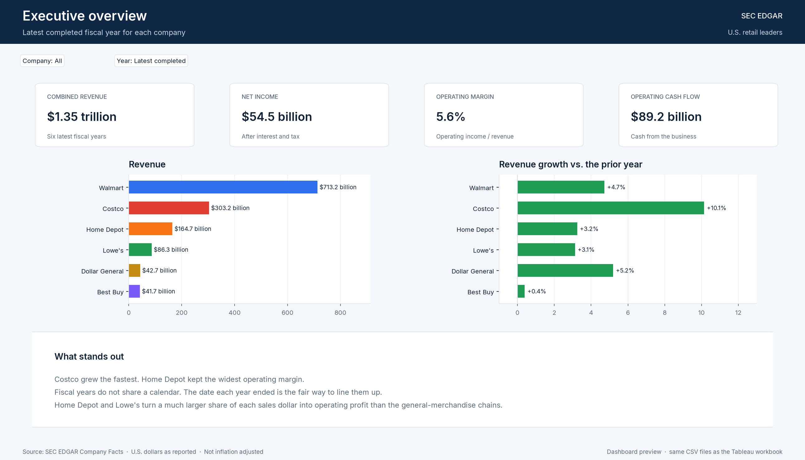
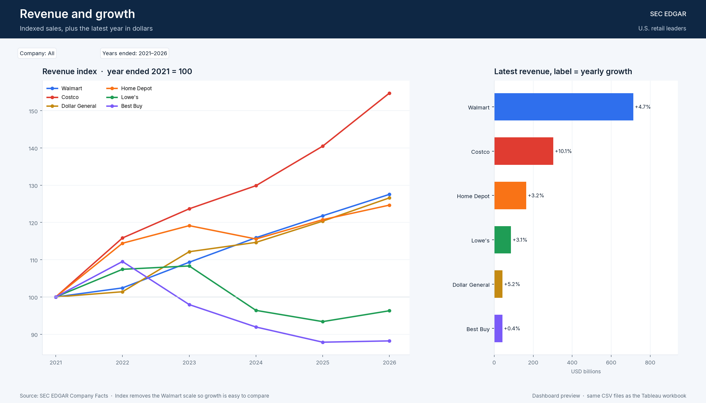
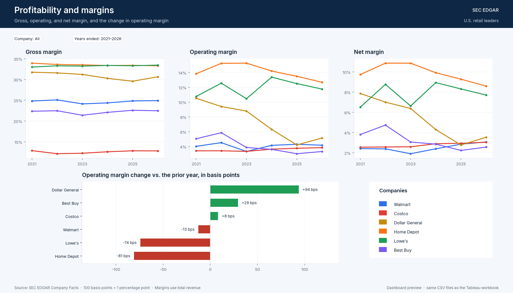
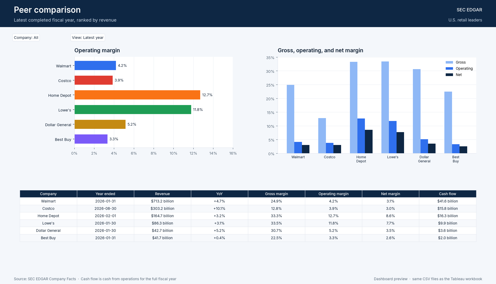

# Corporate Financial Performance Dashboard

Prepared by Tanner Allred.

This project compares six large U.S. retailers on revenue, profit, and cash flow. The figures come straight from their SEC filings. Nothing here is estimated or filled in by hand.

The group is Walmart, Costco, Dollar General, Home Depot, Lowe's, and Best Buy. They were picked because their filings use the same sales, profit, and cash-flow lines for six fiscal years. They do not run the same kind of store. That is the point. The gap in margins shows up once the numbers sit side by side.

## Dashboard previews

These pictures are drawn from the same CSV files the Tableau workbook uses. They are previews for this page. The filters work in the workbook.



The latest completed year for each company. Walmart supplies the scale. Costco supplies the growth.



The left chart sets the year ended in 2021 to 100. That makes the growth paths easy to see.



Home Depot and Lowe's stay in a different margin range from the general-merchandise chains. Dollar General's operating margin has been the most volatile.



## What the numbers say

Taken together, the six companies produced **$1.35 trillion** of revenue, **$76.1 billion** of operating income, and **$54.5 billion** of net income in their latest completed fiscal years. Combined operating margin was **5.6%**. Combined net margin was **4.0%**. They also produced **$89.2 billion** of operating cash flow.

Costco is the growth story. Latest revenue was **$303.2 billion**, up **+10.1%** from the year before. The five-year pace is **+9.1%** a year. Gross margin is only **12.8%**, which fits a warehouse club that sells at a low markup. Membership fees stay inside that gross profit number, because they are part of total revenue and are not in merchandise cost.

Walmart is still in a class of its own on size. Revenue was **$713.2 billion**, up **+4.7%**. Operating margin was **4.2%**, a change of **-13 bps** from the year before. Net income was **$21.9 billion**. The latest twelve months, through July 31, 2026, came to **$735.8 billion**.

Home Depot and Lowe's keep far more of each sales dollar. Home Depot's operating margin was **12.7%**. Lowe's was **11.8%**. Both gave some of that back last year: **-81 bps** at Home Depot and **-74 bps** at Lowe's. Home Depot's latest twelve-month revenue was **$171.2 billion**. Lowe's was **$92.4 billion**.

Dollar General had the biggest margin recovery. Operating margin rose **+94 bps**, to **5.2%**, on **$42.7 billion** of revenue. Best Buy was almost flat, at **$41.7 billion**, up **+0.4%**. Over five years Best Buy's pace is **-2.5%** a year. Lowe's five-year pace is **-0.8%** a year. Lowe's sales were **$97.1 billion** in fiscal 2022, before the Canadian stores left the numbers, and have settled near the latest **$86.3 billion**.

## Latest completed year

Companies do not share one calendar. Home Depot, Lowe's, and Dollar General end in January or February and number that fiscal year as the prior calendar year. Walmart, Costco, and Best Buy use the calendar year of the ending date. The "year ended" column is the clean way to line them up.

The five-year column is the compound pace from the first year in this file to the latest year. The last column is revenue for the latest four quarters, including a current year that is still in progress.

| Company | Fiscal year | Year ended | Revenue | YoY | Five-year pace | Gross margin | Operating margin | Margin change | Net margin | Net income | Operating cash flow | Latest 12 months |
| --- | --- | --- | --- | --- | --- | --- | --- | --- | --- | --- | --- | --- |
| Walmart | 2026 | 2026-01-31 | $713.2 billion | +4.7% | +5.0% | 24.9% | 4.2% | -13 bps | 3.1% | $21.9 billion | $41.6 billion | $735.8 billion |
| Costco | 2026 | 2026-08-30 | $303.2 billion | +10.1% | +9.1% | 12.8% | 3.9% | +8 bps | 3.0% | $9.2 billion | $15.8 billion | $303.2 billion |
| Dollar General | 2025 | 2026-01-30 | $42.7 billion | +5.2% | +4.8% | 30.7% | 5.2% | +94 bps | 3.5% | $1.5 billion | $3.6 billion | $43.6 billion |
| Home Depot | 2025 | 2026-02-01 | $164.7 billion | +3.2% | +4.5% | 33.3% | 12.7% | -81 bps | 8.6% | $14.2 billion | $16.3 billion | $171.2 billion |
| Lowe's | 2025 | 2026-01-30 | $86.3 billion | +3.1% | -0.8% | 33.5% | 11.8% | -74 bps | 7.7% | $6.7 billion | $9.9 billion | $92.4 billion |
| Best Buy | 2026 | 2026-01-31 | $41.7 billion | +0.4% | -2.5% | 22.5% | 3.3% | +29 bps | 2.6% | $1.1 billion | $2.0 billion | $42.2 billion |

Costco's latest twelve months match the full year because the newest quarter is the year-end quarter. A move of 100 basis points is a change of 1 percentage point.

## Where the numbers come from

Downloaded on 2026-11-26 from the free [SEC EDGAR Company Facts API](https://www.sec.gov/search-filings/edgar-application-programming-interfaces). No API key is required. Each file below is the live company feed.

- [Walmart, CIK 0000104169](https://data.sec.gov/api/xbrl/companyfacts/CIK0000104169.json)
- [Costco, CIK 0000909832](https://data.sec.gov/api/xbrl/companyfacts/CIK0000909832.json)
- [Dollar General, CIK 0000029534](https://data.sec.gov/api/xbrl/companyfacts/CIK0000029534.json)
- [Home Depot, CIK 0000354950](https://data.sec.gov/api/xbrl/companyfacts/CIK0000354950.json)
- [Lowe's, CIK 0000060667](https://data.sec.gov/api/xbrl/companyfacts/CIK0000060667.json)
- [Best Buy, CIK 0000764478](https://data.sec.gov/api/xbrl/companyfacts/CIK0000764478.json)

`data/data_sources.json` records the same links, the CIKs, the date range, the filing tags, and the download time. `data/dim_company.csv` holds the company list. The annual and quarterly amounts are in `data/company_financials_annual.csv` and `data/company_financials_quarterly.csv`.

## How the measures are built

- Revenue, cost, operating income, net income, and operating cash flow are the values reported in the 10-K or 10-Q.
- Gross profit uses the company's own gross profit line when that line is tagged. Otherwise it is revenue minus cost. For Walmart, revenue is total revenue, so membership and other income stays inside gross profit. The same is true for Costco's membership fees.
- These retailers do not tag a standalone fourth quarter in the feed. Fourth-quarter sales and profit are the full year minus the reported first, second, and third quarters. Quarterly cash flow is stored only when the filing tags that quarter on its own.
- Year-over-year growth, margins, margin change in basis points, and trailing twelve-month revenue are calculated from those amounts. The Tableau formulas are written out in [tableau/calculated_fields.md](tableau/calculated_fields.md).

## Open the workbook

1. Install [Tableau Public](https://www.tableau.com/products/public) (free) or Tableau Desktop.
2. Download this repository.
3. Open `tableau/CorporateFinancialsDashboard.twbx`. The CSV files are packed inside it.
4. If you open `tableau/CorporateFinancialsDashboard.twb` instead and Tableau asks for the data, point it at the `data` folder.
5. Use the Company and Year filters. The four dashboards are Executive Overview, Revenue & Growth, Profitability & Margins, and Peer Comparison.

## Refresh the data

From the repository root:

```bash
python scripts/fetch_data.py
python scripts/build_workbook.py
python scripts/build_previews.py
python scripts/validate_portfolio.py
```

`fetch_data.py` calls the SEC feed again and rewrites the CSV files. The preview script needs the packages in `requirements.txt`. The validator checks that the workbook XML is well formed, that the write-up uses only figures from the CSV files, and that the pictures are linked. Add `--live` if you also want it to re-download the SEC files and compare them with the CSV.

## Project files

- `data/` holds the SEC extracts and the source notes
- `tableau/` holds the workbook and the calculated-field guide
- `assets/` holds the four preview images
- `scripts/` downloads the filings, draws the previews, builds the workbook, and checks the result
